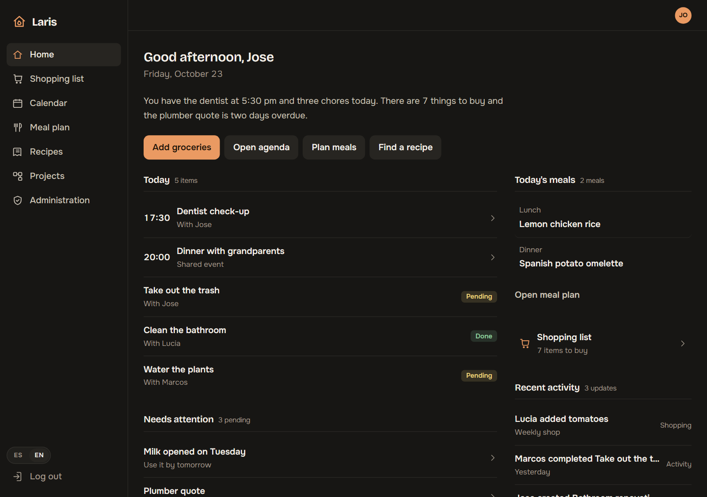
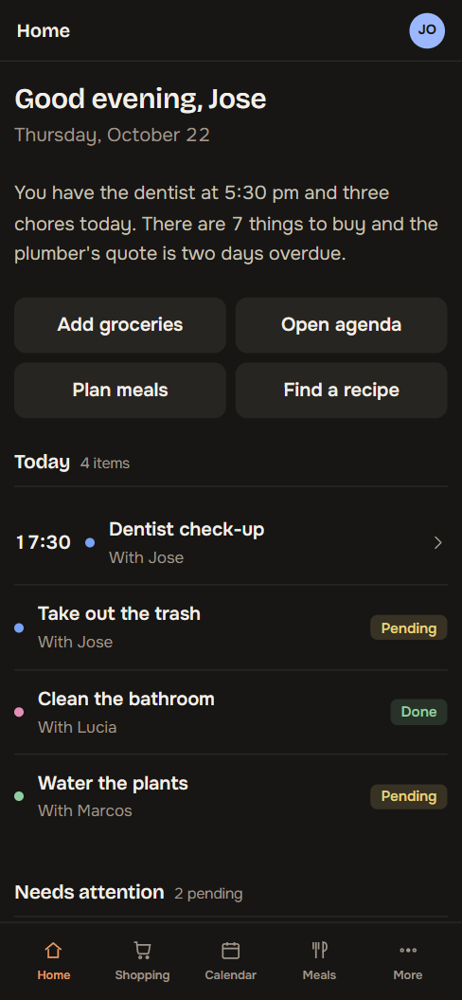
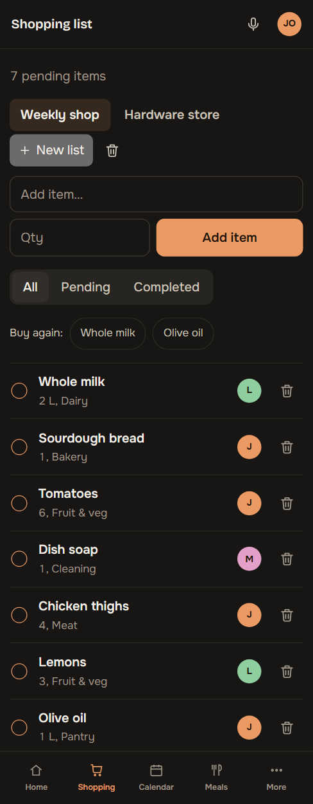
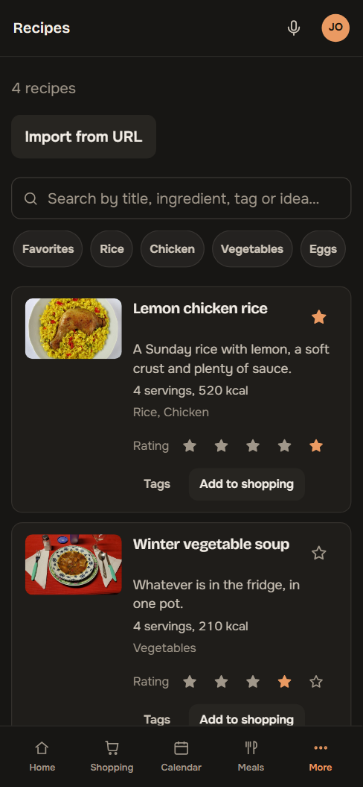
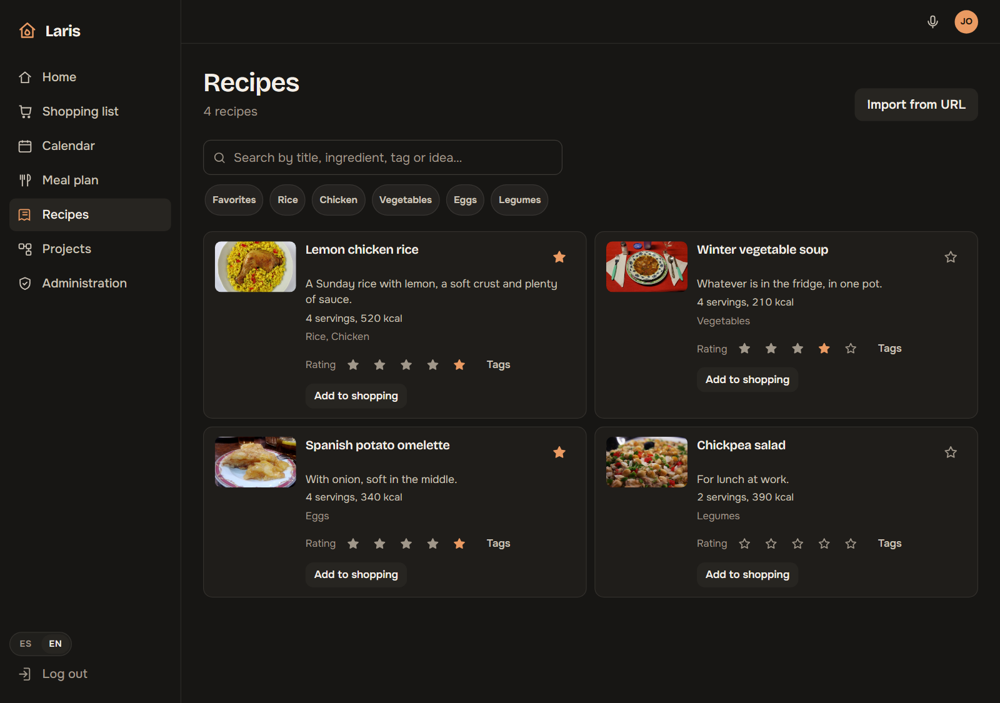
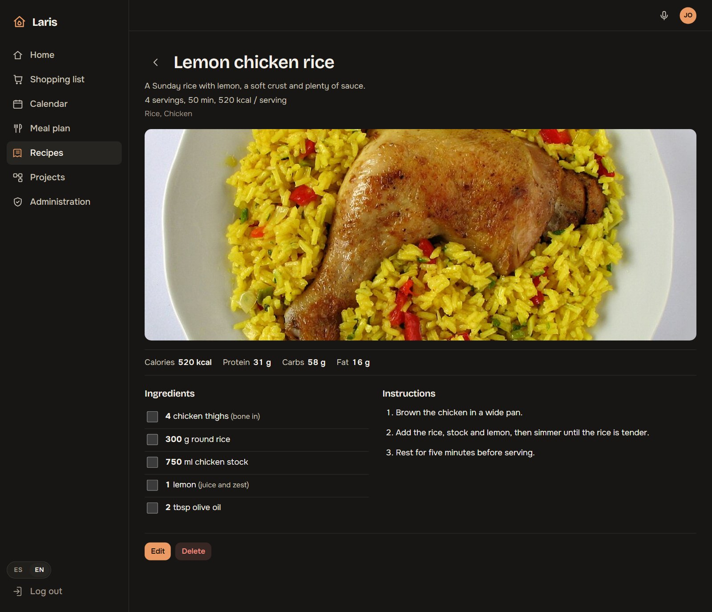
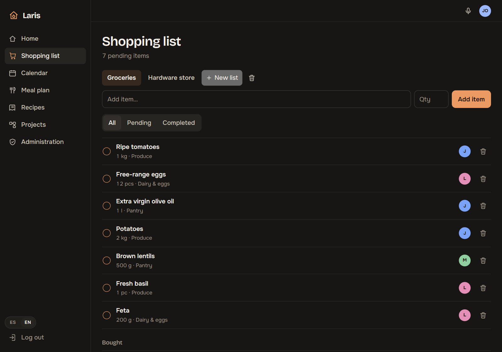
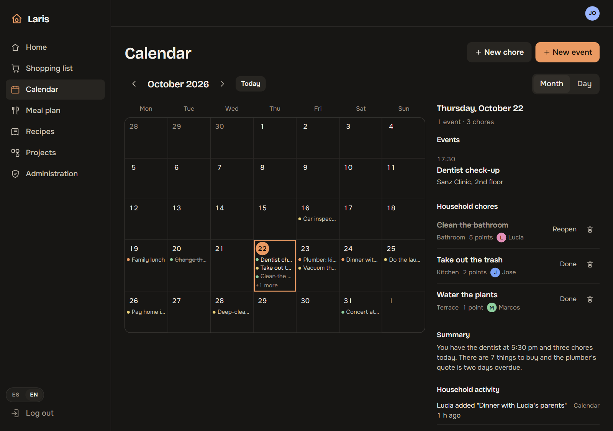
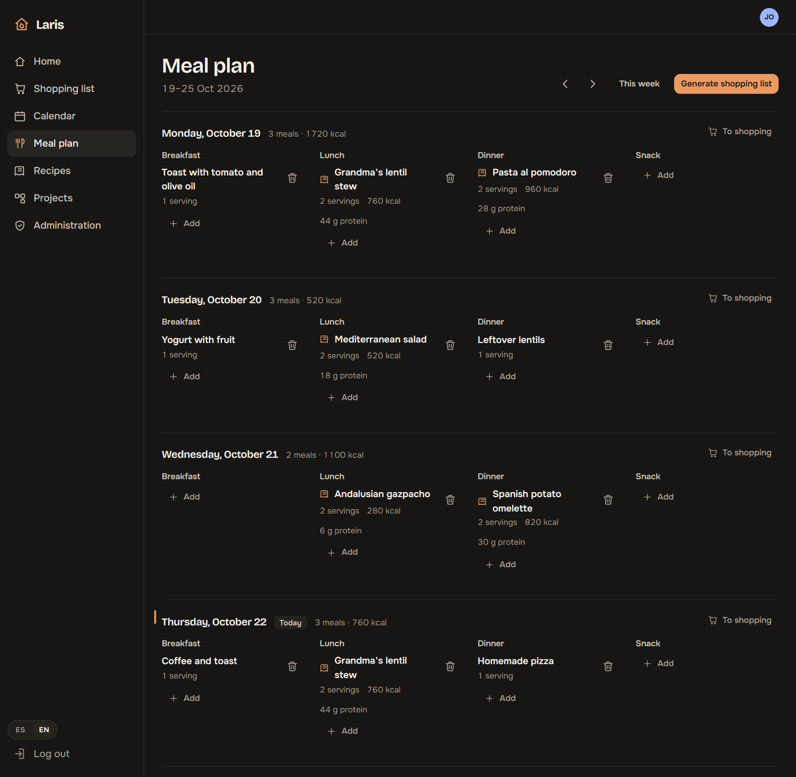
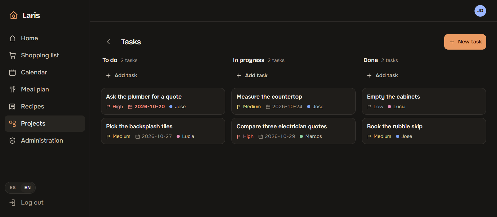

# Laris Home

A web app for running a shared household: shopping lists, a calendar with household chores, a meal planner, a recipe book and small projects. It's a personal project I started so my partner and I would stop splitting this across four apps and chat threads, and it doubles as a way to work on a full stack (PWA, API, Postgres, LLMs, voice) with things that don't usually show up in a CRUD app.

The UI is available in English and Spanish (switch in the sidebar).



> Screenshots are taken against a mocked API with sample data (no real household data). Recipe photos come from Wikimedia Commons.

## Features

- **Multi-user households.** Each user belongs to a household with an admin or member role. There is no public sign-up: the first admin is created when the database is empty, and admins add everyone else.
- **Shopping lists.** Multiple lists, categories, duplicate detection when adding an item (offers to merge) and "buy again" suggestions.
- **Calendar.** Events (personal, shared, reminders) plus recurring household chores with points and a per-person scoreboard.
- **Meal planner.** Weekly plan with kcal and macros per day, and a shopping list generated from the week's recipes (with preview and duplicate merging).
- **Recipes.** Import from a URL, text and semantic search, favorites, ratings and tags.
- **Projects.** Task board (to do / in progress / done) with priority, due date and assignee.
- **Daily summary** on the home screen, written by an LLM with a plain fallback text when no AI provider is configured.
- **Voice input** to add shopping items and to search or propose recipes.
- **Installable PWA** with offline cache and web push notifications.

<table>
  <tr>
    <td></td>
    <td></td>
    <td></td>
  </tr>
</table>

## Screens

**Recipes.** Search, tags, favorites and ratings. The image is picked up from the source page on import.



**Recipe detail.** Ingredient checkboxes so only what you're missing goes to the shopping list, plus the method.



**Shopping list.** Several lists, filters, and who added each item.



**Calendar.** Month view with the selected day's events and chores.



**Meal plan.** A full week with kcal per day and a shortcut to send a day's ingredients to the shopping list.



**Projects.** Task board by status, with priority, due date and assignee.



## Stack

| Layer | Technology |
| --- | --- |
| Client | React 18, TypeScript, Vite, React Router, Zustand, dnd-kit, hand-written CSS (no UI framework) |
| Server | Node.js, Express, TypeScript, Zod |
| Database | PostgreSQL 16 with pgvector |
| AI | OpenRouter (LLM), Deepgram (speech recognition), Transformers.js (local embeddings) |
| Deployment | Docker Compose (dev, and prod with nginx) |
| Quality | Vitest, Playwright, GitHub Actions |

## Getting started

You need Docker and Docker Compose. `POSTGRES_PASSWORD` and `JWT_SECRET` are required; `OPENROUTER_API_KEY` and `DEEPGRAM_API_KEY` are only needed for the AI and voice features (everything else works without them).

```bash
cp .env.example .env        # then fill in POSTGRES_PASSWORD and JWT_SECRET
docker compose up --build
docker compose exec server npm run migrate
```

The app is served at http://localhost:5173. If the database is empty, the UI offers to create the first administrator (there is also `POST /api/auth/register-first-admin`, which stops working once a user exists).

Production (nginx serving the client, port 8080):

```bash
docker compose -f docker-compose.prod.yml up -d --build
```

`npm run seed` loads demo data and **deletes existing data**; don't run it against a real database.

### Main environment variables

| Variable | Purpose |
| --- | --- |
| `POSTGRES_PASSWORD`, `JWT_SECRET` | Required |
| `OPENROUTER_API_KEY`, `OPENROUTER_MODEL` | LLM (import, summary, voice) |
| `DEEPGRAM_API_KEY`, `DEEPGRAM_LANGUAGE` | Voice transcription |
| `VAPID_*` | Web push notifications |
| `EMBEDDINGS_PROVIDER` | Empty: local model. `mock`: fake vectors for tests |
| `DB_BACKUP_INTERVAL_SECONDS`, `DB_BACKUP_RETENTION_DAYS` | Backups (defaults: every 24 h, keep 7 days) |

The full list is in [`.env.example`](.env.example). Backups are written to `./backups/postgres`; to force one: `docker compose exec db-backup sh /usr/local/bin/backup.sh once`.

## License

MIT. See [LICENSE](LICENSE).
